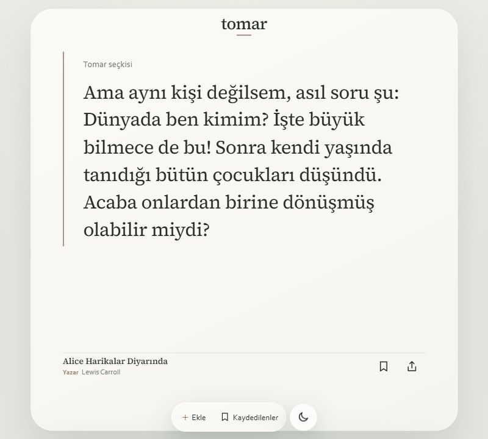
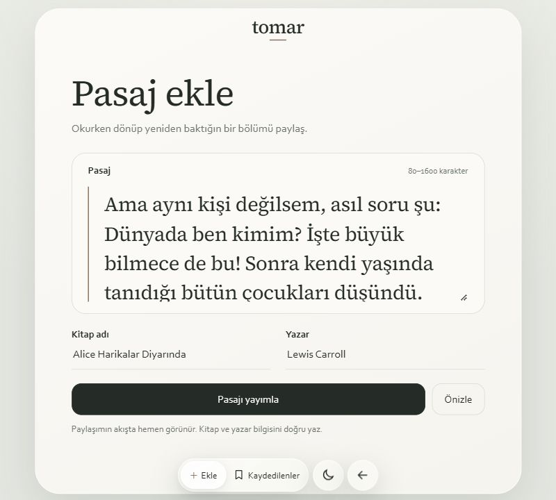
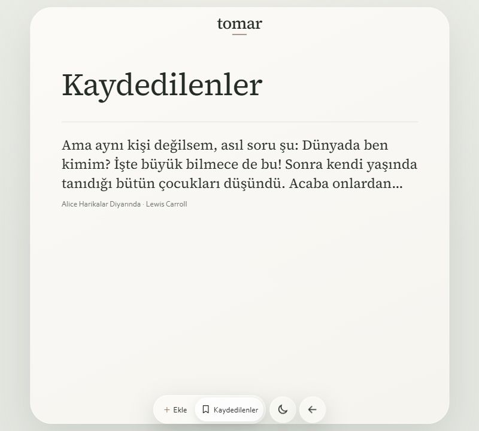
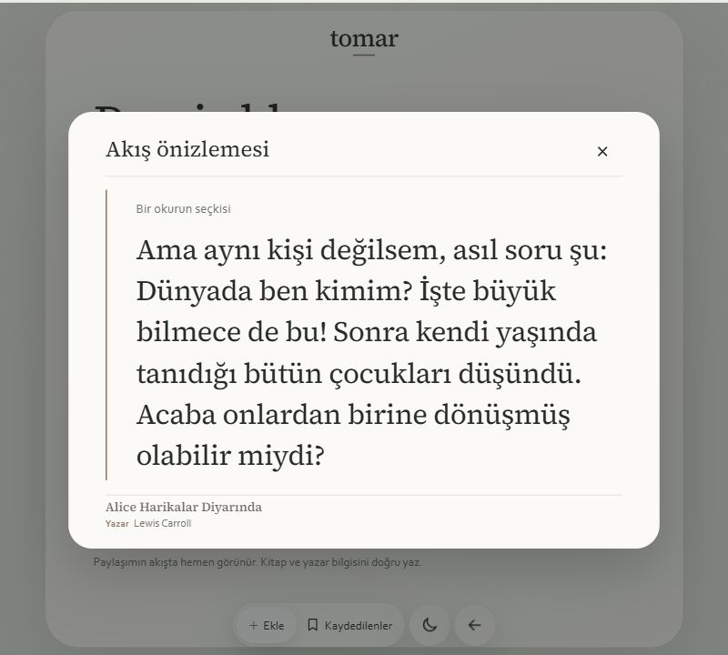
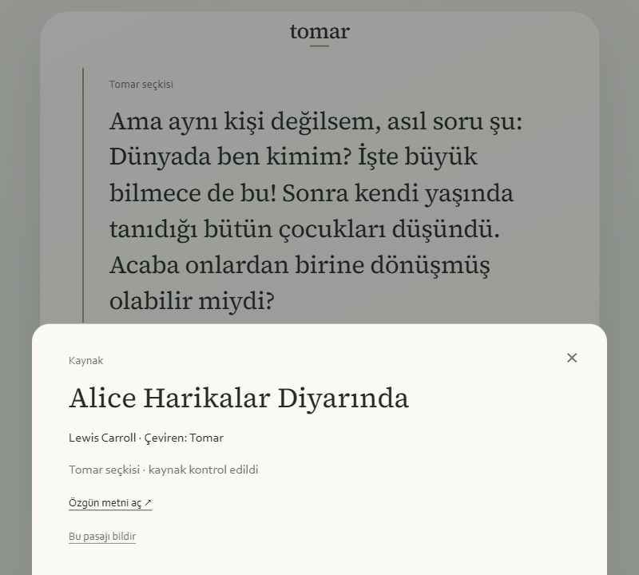
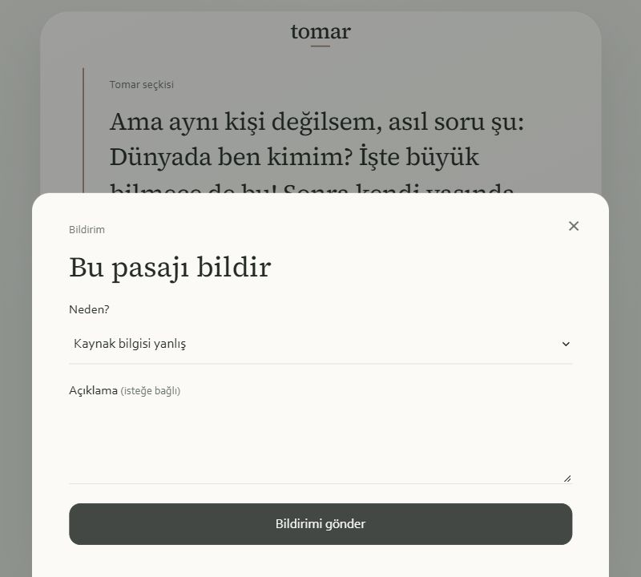
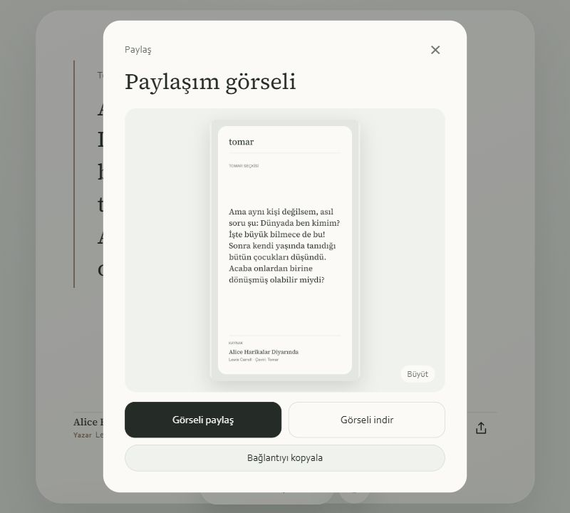
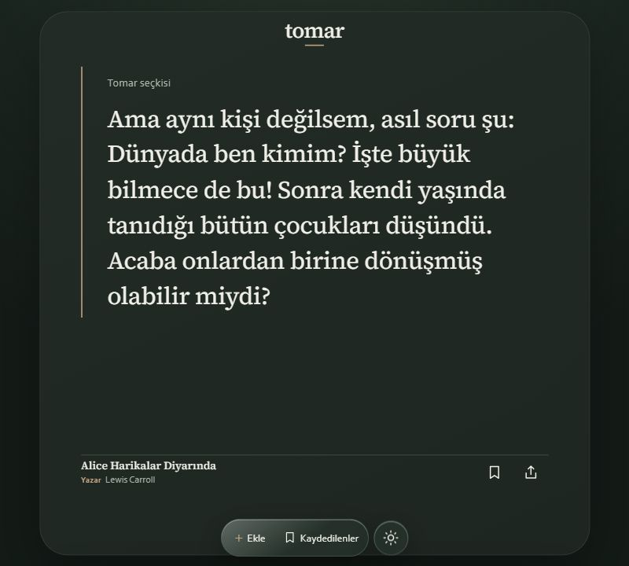
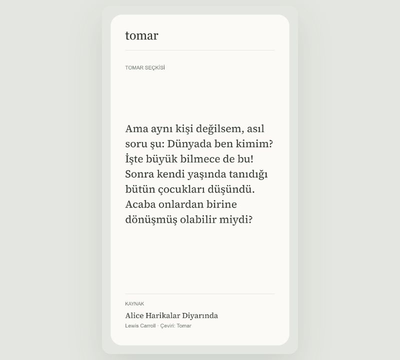

# Tomar

Tomar, Türkçe ve dünya edebiyatından kitap pasajlarını keşfetmek ve paylaşmak için mobil öncelikli bir web uygulaması. Her ekranda bir pasaj var. Kaydırarak okumaya devam edebilir, beğendiğin pasajı kaydedebilir veya kitap ve yazar bilgileriyle birlikte kendi seçtiğin bir bölümü akışa ekleyebilirsin.

[Canlı uygulamayı aç](https://ttomar.online/)

## Ekran görüntüleri

| Ana akış | Pasaj ekle | Kaydedilenler |
| :---: | :---: | :---: |
| [](docs/screenshots/01-ana-akis.jpg) | [](docs/screenshots/02-pasaj-ekle.jpg) | [](docs/screenshots/03-kaydedilenler.jpg) |

<details>
<summary>Kaynak, paylaşım ve diğer ekranları göster</summary>

| Pasaj önizleme | Pasaj kaynağı | Pasaj bildir |
| :---: | :---: | :---: |
| [](docs/screenshots/04-pasaj-onizleme.jpg) | [](docs/screenshots/05-pasaj-kaynagi.jpg) | [](docs/screenshots/06-pasaj-bildir.jpg) |

| Paylaşım görseli | Koyu tema | Büyük paylaşım önizlemesi |
| :---: | :---: | :---: |
| [](docs/screenshots/07-paylasim-gorseli.jpg) | [](docs/screenshots/08-koyu-tema.jpg) | [](docs/screenshots/09-paylasim-buyuk-onizleme.jpg) |

</details>

## Nasıl çalışır?

- **Oku.** Tomar seçkisi ve okur gönderileri aynı dikey akışta ayrı etiketlerle görünür. Akışın sonuna gelindiğinde pasajlar karışık sırayla yeniden gösterilir.
- **Ekle.** Kitap adı ve yazarıyla birlikte 80–1600 karakterlik bir pasaj gir. Önizlemeden sonra hesap açmadan yayımlayabilirsin. Gönderin ortak akışta bir okur seçkisi olarak görünür.
- **Kaydet.** Kaydettiklerin, tema tercihin ve kaldığın pasaj tarayıcıda saklanır.
- **Paylaş.** Bir pasajı PNG kart olarak indir veya doğrudan o pasaja açılan bağlantıyı kopyala. Destekleyen cihazlarda kartı paylaşım menüsünden de gönderebilirsin.
- **Kaynağa bak.** Kitap adına dokunarak yazar, varsa çevirmen ve metnin kaynak bağlantısını görebilirsin. Aynı ekrandan yanlış kaynak, telif veya spam bildirimi gönderebilirsin.

## Kullanılan teknolojiler

| Katman | Teknoloji | Görevi |
| --- | --- | --- |
| Web arayüzü | React, TypeScript, Vite, CSS, Source Serif 4 | Pasaj akışı, gönderi formu, önizleme ve temalar |
| API | Node.js, Fastify, `pg` | Akışı sayfalar halinde sunar, gönderileri ve bildirimleri doğrulayıp PostgreSQL'e yazar |
| Veri | PostgreSQL ve `localStorage` | PostgreSQL ortak pasajları ve bildirimleri, tarayıcı ise kişisel okuma tercihlerini saklar |
| Paylaşım | Canvas API | Pasajı ve kaynak bilgisini tarayıcıda PNG karta dönüştürür |
| Yayın | Docker ve Caddy | Uygulama konteynerde çalışır, Caddy HTTPS trafiğini Tomar'a iletir |

## Yerelde çalıştırma

Node.js 22.12+ ve npm gerekir.

### Hızlı önizleme

```sh
npm ci
npm run dev:demo
```

Tarayıcıda [yerel önizlemeyi](http://127.0.0.1:5173/) aç. Bu mod seçki dosyasından okur. Eklediğin pasajlar ve gönderdiğin bildirimler o tarayıcıda kalır. PostgreSQL kurulumu gerekmez.

### PostgreSQL ile tam kurulum

Bağımlılıkları `npm ci` ile kur ve yerel PostgreSQL bağlantısını hazırla.

- **Docker Compose.** Proje kökünde `.env.example` dosyasını `.env` olarak kopyala ve `docker compose up -d db` komutunu çalıştır.
- **Mevcut PostgreSQL.** `.env.example` dosyasını `.env` olarak kopyala ve `DATABASE_URL` değerine kendi bağlantı adresini yaz.
- **Windows'ta PostgreSQL 18.** `npm run db:local` ile 5433 portunda projeye özel bir veritabanı başlatabilirsin. Betik, `.env` dosyası henüz yoksa bağlantı ayarlarıyla birlikte oluşturur.

PostgreSQL hazır olduğunda seçkiyi yükle ve uygulamayı başlat.

```sh
npm run seed:curated
npm run dev
```

Web arayüzü `http://127.0.0.1:5173`, API `http://127.0.0.1:3001` üzerinden çalışır. Şema otomatik hazırlanır.

## İçerik ve geliştirme

- [Seçki dosyası](content/curated-passages.json) pasaj metnini, eser ve yazar bilgisini, varsa çevirmeni ve kaynak bağlantısını içerir. `npm run seed:curated` aynı metni ve yazarı tekrar eklemez. İnceleme bekleyen eserler [hak kuyruğunda](content/rights-queue.md) tutulur.
- [Arayüz](src/) React bileşenlerini, demo modunu ve paylaşım kartı üretimini içerir. [Sunucu](server/) API'yi, PostgreSQL şemasını, içerik yükleme ve moderasyon komutlarını içerir.

```sh
npm run check
npm test
npm run build
npm start
```

`npm start` üretim derlemesini `.env` içindeki PostgreSQL bağlantısıyla çalıştırır. Derlemeden sonra `npm run moderate -- list` açık bildirimleri listeler. `npm run moderate -- remove <pasaj-id>` pasajı yayından kaldırır ve ilgili bildirimleri kapatır. `npm run moderate -- resolve <bildirim-id>` bildirimi kapatır.
